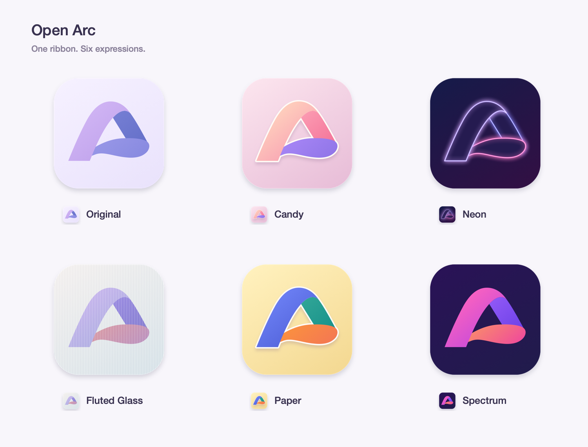

<p align="center">
  
</p>

<h1 align="center">Open Arc</h1>

<p align="center">
  <strong>An independent, open-source macOS browser built on Chromium, made out of love for Arc.</strong>
</p>

<p align="center">
  <a href="https://github.com/St0neWan9/open-arc-browser/releases/latest"></a>
  
  
  
  <a href="LICENSE"></a>
</p>

<p align="center">
  <a href="https://github.com/St0neWan9/open-arc-browser/releases/latest">Download</a> ·
  <a href="https://getopenarc.app/">Website</a> ·
  <a href="https://getopenarc.app/help">Help</a> ·
  <a href="https://getopenarc.app/privacy">Privacy</a> ·
  <a href="https://github.com/St0neWan9/open-arc-browser/issues">Issues</a>
</p>

> [!IMPORTANT]
> Open Arc is an unofficial, community-built open-source project. It is not made by, endorsed by or affiliated with The Browser Company, and it is not meant to infringe anyone's copyright or trademarks. See [Legal notice](#legal-notice).

## Why this exists

Arc changed how many of us use a browser. Spaces, a sidebar instead of a tab strip, and tabs that clean up after themselves became habits that are hard to give up. Open Arc grew out of that affection: a browser that keeps those habits alive and whose source anyone can read.

It is a tribute, not a competitor. The goal is for Arc's interaction and look to feel familiar, while the code, icons and artwork are our own.

## Features

**Organizing**

- **Spaces** with their own theme colors and icons, and **Profiles** to keep sign-ins separate.
- **Sidebar** with Favorites, pinned tabs, nested folders and Today tabs.
- **Auto-archive** for idle tabs, which stay ready to reopen.
- **Library** for downloads, media, Spaces and Easels.

**Browsing**

- **Command bar** for searching, opening pages and running commands.
- **Split View** with two to four pages side by side.
- **Peek** to preview a link over the current page.
- **Little Arc**, a small window for quick lookups and links from other apps.
- **Air Traffic Control** to send links from chosen sites to a chosen Space.
- **Easel**, a canvas for screenshots, images, text and notes.

**Engine**

- Chromium 157, with extensions from the Chrome Web Store.
- Password saving and autofill, page translation, page capture and picture in picture.
- Built-in ad and tracker blocking, on by default.
- AppleScript support.

**Moving in**

- Import from Arc: Spaces, theme colors, supported icons, nested folders, pinned tabs, Favorites, Today tabs and split views. Unrecognized items may be skipped.
- Import bookmarks from Chrome, Safari, Brave, Edge, Chromium and Vivaldi.
- Six app icons to choose from in Settings.

<p align="center">
  
</p>

### Not included

- Boosts, Notes, Live Folders, Cast and Arc's AI features.
- DRM-protected video (no Widevine).
- Safe Browsing and client-side phishing detection.
- Passkeys from iCloud Keychain. The Apple entitlement they need has been requested and is still pending.
- Automatic pickup of sites' own search engines (OpenSearch), and warnings about breached passwords.
- Windows, Linux, iOS and Intel Mac builds.

## Install

Download the latest `.dmg` from [Releases](https://github.com/St0neWan9/open-arc-browser/releases/latest) and drag Open Arc into Applications. It needs macOS 14 or later on Apple silicon.

Release builds are signed with a Developer ID, notarized by Apple, and update themselves through Sparkle (**Open Arc ▸ Check for Updates…**).

## Your data

- Your sidebar, history, passwords, cookies, downloads and settings stay on your Mac.
- There is no Open Arc account and no Open Arc server.
- The app shares a few basic usage events with an analytics service in the US unless you turn it off in Settings ▸ General: that it was used on a day, which of five features were used, Arc import results and the archive interval. It never sends websites, page contents, searches or anything from incognito windows, and it starts only after telling you.
- iCloud sync is optional and off by default. It syncs supported Spaces and sidebar content through your own private iCloud database. Profiles and signed-in sessions stay on your Mac.
- Crash reports stay on your Mac until you choose to share one.

The [privacy policy](https://getopenarc.app/privacy) lists every connection the app makes on its own.

## Build from source

You need macOS 14 or later and Xcode 16 or later. The project has only been verified with Xcode 26 and Swift 6.3.

### App shell only

This is the quickest way to work on the interface. Without the Chromium framework, the app runs on `FakeEngine`, a stand-in that does not load real web pages.

```sh
git clone https://github.com/St0neWan9/open-arc-browser.git
cd open-arc-browser/app
swift build
swift test
```

To build an app bundle, run this from the repository root:

```sh
scripts/make-app.sh --dev
open "build/Open Arc Dev.app"
```

The development build has its own bundle id and data directory, so it never touches a release install. It is signed ad hoc and only runs on the machine that built it. iCloud sync needs a Developer ID build with a provisioning profile.

### With the Chromium engine

The engine is Chromium plus an ordered series of patches. Building Chromium needs [depot_tools](https://chromium.googlesource.com/chromium/src/+/main/docs/mac_build_instructions.md) and a lot of time and disk space.

1. Fetch Chromium into `~/chromium`, then check out the tag listed in [`chromium-patches/157/BASE`](chromium-patches/157/BASE) and run `gclient sync` and `gclient runhooks`.
2. Apply our patches with `chromium-patches/apply.sh`.
3. Create `out/Release/args.gn` as shown in [`chromium-patches/README.md`](chromium-patches/README.md#building), then run `gn gen out/Release`.
4. Run `chromium-bridge/build-framework.sh`. It builds the framework and places it at `app/Vendor/OpenArcCore.xcframework`.
5. Run `scripts/make-app.sh --dev` again. The package picks up the framework automatically.

## Project layout

| Path | What it holds |
|---|---|
| [`app/`](app/README.md) | The Swift package: the SwiftUI and AppKit shell, data model, engine protocols, persistence, import and CloudKit sync |
| [`chromium-bridge/`](chromium-bridge/README.md) | The Objective-C API between Swift and Chromium, and the framework build script |
| [`chromium-patches/`](chromium-patches/README.md) | Our patch series on top of upstream Chromium releases |
| [`scripts/`](scripts/) | App bundling, notarization, icon export and performance checks |
| [`branding/`](branding/README.md) | The Open Arc identity and app icons |

The shell only talks to the `BrowserEngine` protocol, so most interface work needs neither Chromium nor a real network. Module boundaries and the dependency graph are described in [`app/README.md`](app/README.md).

## Contributing

Bug reports, ideas and pull requests are welcome. See [`CONTRIBUTING.md`](CONTRIBUTING.md) for how to report a bug and how to submit a pull request.

## Legal notice

Open Arc is a non-commercial open-source project, built out of love for Arc. We have no intention of infringing the copyright, trademarks or other rights of The Browser Company or anyone else.

- **No affiliation.** Open Arc is not made by, endorsed by, sponsored by or affiliated with The Browser Company.
- **Trademarks.** Arc, The Browser Company and their logos belong to their respective owners. The name Arc and Arc's feature names appear here and in the app only to describe what inspired the project, to help Arc users find their way around, and to identify the data the app can import. Chrome, Chromium, iCloud, macOS and other names belong to their respective owners too.
- **Our own work.** This repository contains no Arc source code, binaries, artwork or logos. Open Arc's interface deliberately follows Arc's design: behavior was worked out by using Arc and studying the released app, then written from scratch in our own code. The app icons and brand artwork are original.
- **Your Arc data.** Importing reads your own local Arc sidebar file, read-only. Open Arc does not modify Arc or its data.
- **Concerns.** If you represent a rights holder and something here concerns you, please [open an issue](https://github.com/St0neWan9/open-arc-browser/issues). We will respond promptly and change or remove whatever is needed.

## License

Open Arc is released under the [BSD-3-Clause license](LICENSE), the same license Chromium uses. Chromium, Sparkle and other third-party components keep their own licenses.

The license covers the code. It does not grant rights to the Open Arc name or app icons.

## Acknowledgements

- The Browser Company and the Arc team, for making a browser worth loving.
- [Chromium](https://www.chromium.org/), the engine underneath.
- [Sparkle](https://sparkle-project.org/), for software updates.
- [EasyList and EasyPrivacy](https://easylist.to/), the filter lists behind ad blocking.
