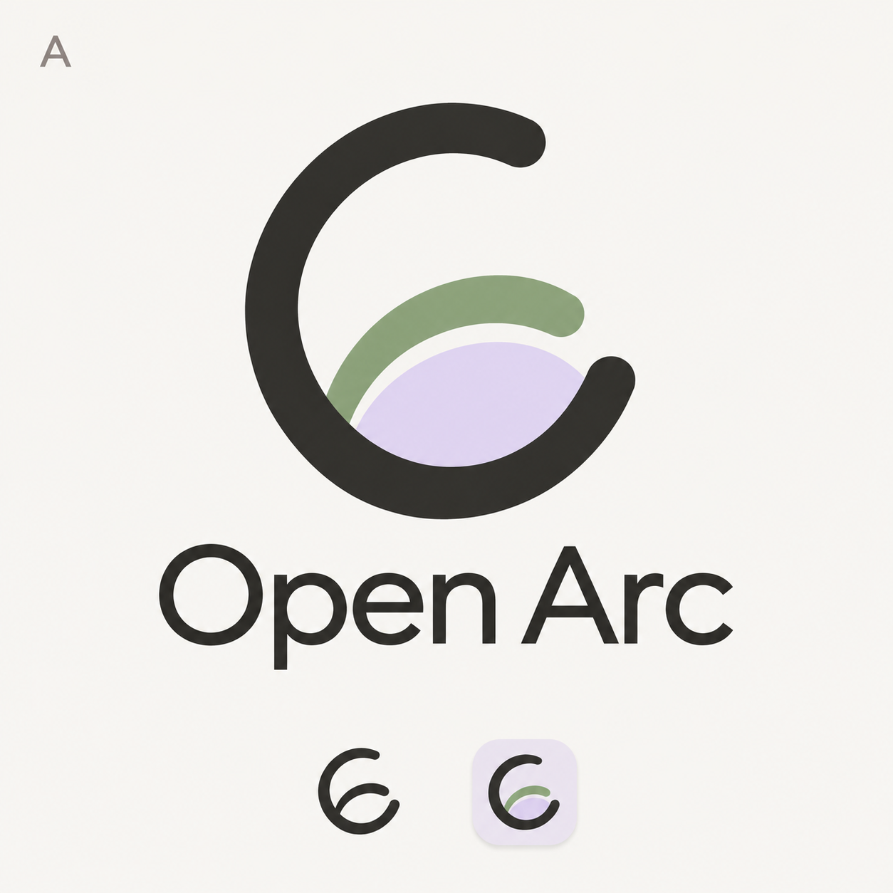
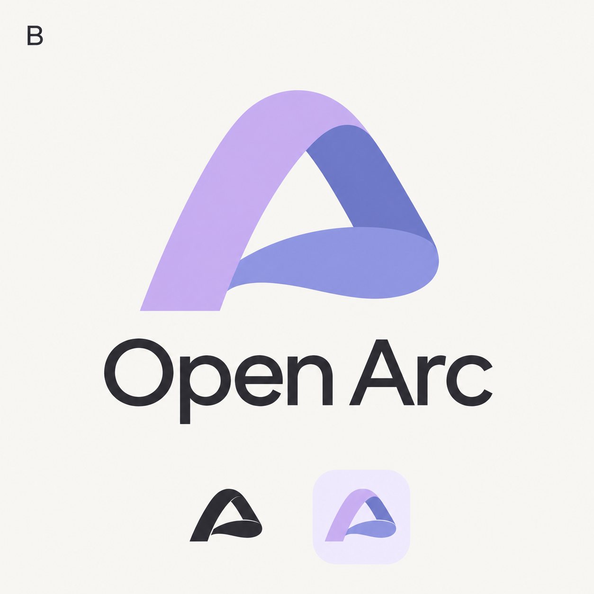
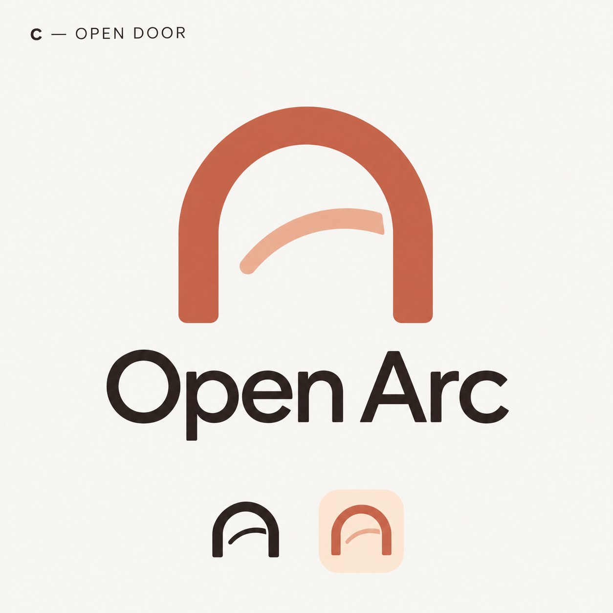
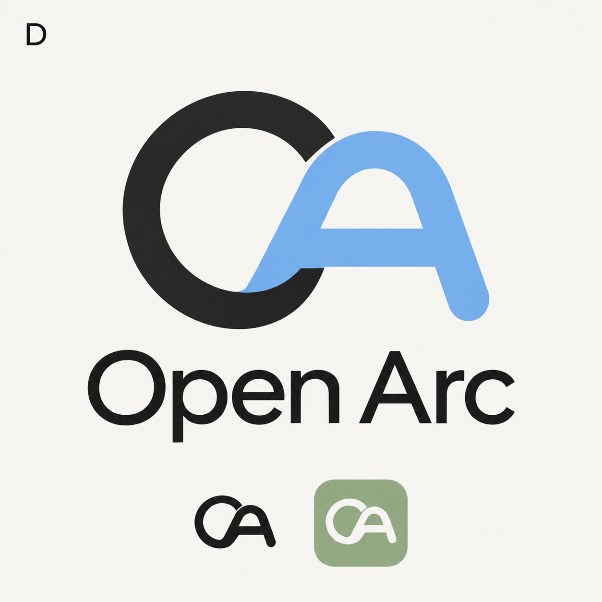

# Logo exploration — November 4, 2026

Four concept previews generated with the built-in imagegen tool. These are proposals for selection; the current site and native application logo remain unchanged. The selected concept should be refined into a vector master before production use.

## Prompt composition

Each request used the shared prompt below, followed by its concept direction, and the sentence `The only small corner label is 'X'.` with the corresponding concept letter.

Use case: logo-brand. Create ONE polished original logo concept presentation for Open Arc, an independent open-source macOS browser emphasizing personal spaces, openness, and continuity. Square image, warm ivory #f8f7f3 background, restrained premium editorial design matching a calm pastel landing page. Main symbol large centered upper-middle, below it exact wordmark 'Open Arc' in refined clean sans serif, small concept letter at top left, and a tiny monochrome version plus a small rounded-square macOS app icon version at bottom. Plenty of negative space. Flat vector-like precise geometry; clear legibility at favicon size. No photos, no 3D scenery, no mockup devices, no decorative stars or arrows, no imitation of Arc's rainbow A logo.

## A — Open orbit

Concept A — OPEN ORBIT. A bold single circular arc with a deliberate opening at upper-right and gently rounded terminals, an offset inner arc creates an understated O/A suggestion. Use deep charcoal and sage green with a subtle lavender secondary surface. Memorable asymmetric open circular silhouette, only two simple curved shapes.

## B — Folded arc

Concept B — FOLDED ARC. A single continuous curved ribbon folds over itself into an arch and an open loop, the negative space lightly suggests an A. Soft lavender and muted periwinkle with deep charcoal wordmark. Flat color planes, no photoreal shading, no rainbow. Sculptural but extremely simple, two or three broad surfaces.

## C — Open door

Concept C — OPEN DOOR. A distinctive architectural rounded arch, open at bottom, with an offset short inner curved stroke that suggests a window or horizon. Warm terracotta and dusty peach, deep ink wordmark. Balanced stable silhouette, welcoming and tactile, very spare geometry. Avoid religious shapes.

## D — OA monogram

Concept D — OA MONOGRAM. Invent an exceptionally clean interlocking O and A symbol using one uniform thick rounded stroke. The O is broken open where it meets the A, and the A uses a curved crown rather than sharp point. Near-black ink and pale sky blue, with muted sage small app tile. Strong graphic identity that also works entirely monochrome.
