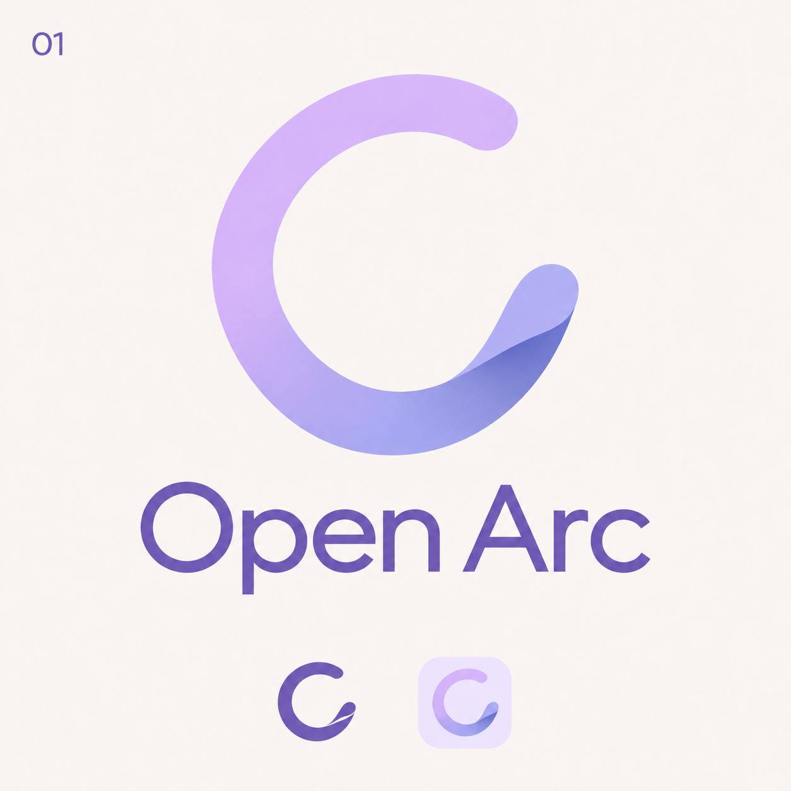
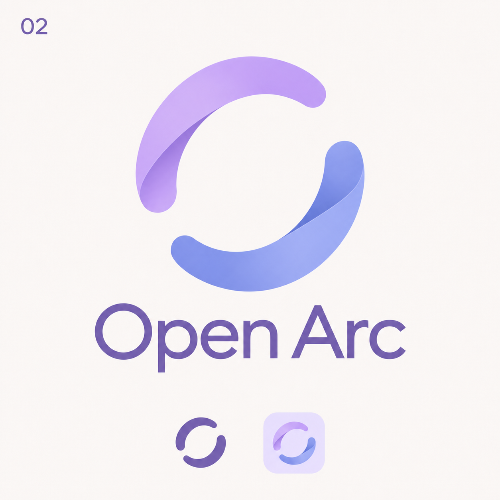
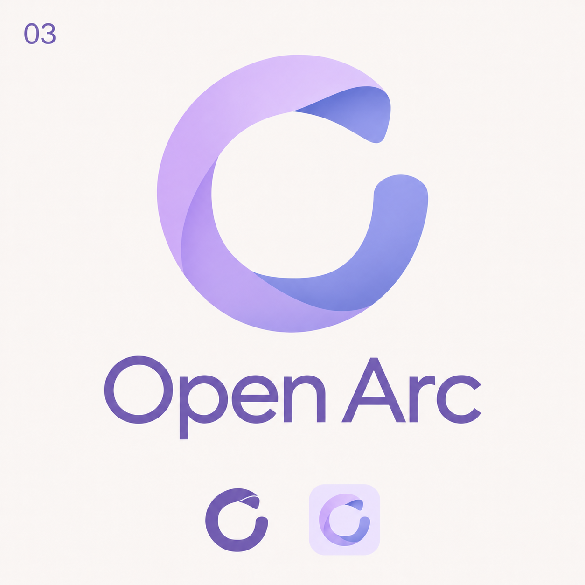
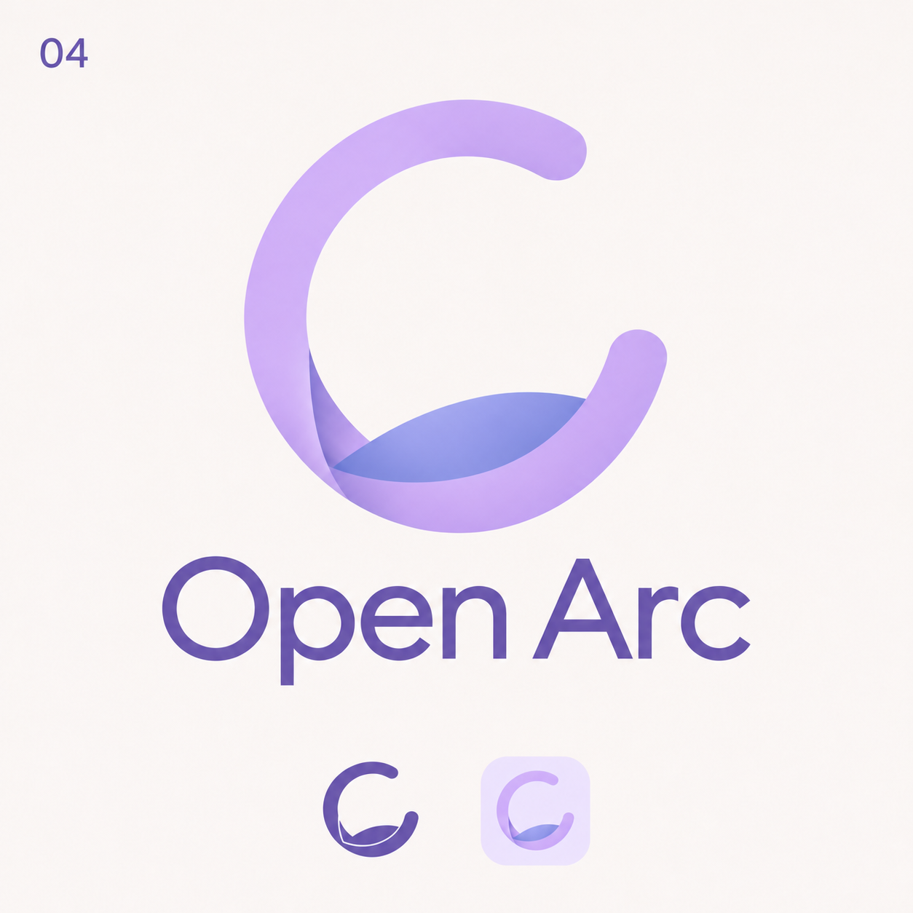

# Open Arc logo exploration — round 2

Status: four concepts for selection; no production logo has been replaced.

Generated with the built-in imagegen tool. The references are the first-round Open orbit and Folded arc concept boards.

The user requested an open circular structure combined with lavender/periwinkle folded surfaces, followed by a requirement to avoid pure black. The final boards use a purple wordmark and purple single-color samples.

## Shared generation prompt

Use case: logo-brand. Create a NEW Open Arc browser logo concept, combining the OPEN CIRCULAR silhouette idea from reference image 1 with the subtle folded ribbon material and lavender/periwinkle palette of reference image 2. The references are inspiration only, not edit targets. Crucial: this must have an open O / circular arc silhouette, NOT an A, triangular arch, or A with a curved crossbar. No rainbow, no globe, no animal, no arrowhead, no familiar browser swirl. A distinctive restrained identity, structurally simple enough to redraw as vector and recognize at 24px. Two or three broad surfaces maximum, precise graceful curves, subtle tonal fold shading rather than glossy 3D, quiet premium quality. Presentation: square warm ivory background, one large centered symbol, exact wordmark 'Open Arc' below in refined clean sans serif. At bottom show the SAME mark in monochrome and on a small pale-lavender rounded-square app tile; preserve the open gap in small versions. Plenty of whitespace, no other decorative graphics.

## 01 — Folded opening

One broad near-circular ribbon forms an open O with a gap at 2 o'clock. The lower free end has ONE small folded-back lip, exposing a darker periwinkle underside, while the upper end is rounded and lavender. Large empty circular counter. A light twist only at the lip, no inner spiral, no crossbar. The center of the mark is mostly empty. This should feel like a single strip of paper gently opening.

Final prompt suffix: Put the exact small label '01' at the top-left. Do not print the concept name.

## 02 — Offset arcs

Two substantial curved ribbon segments, one lavender and one periwinkle, form a loosely enclosed O but are slightly offset diagonally. Two clearly visible clean gaps opposite one another, negative space runs through them. One short overlap creates a precise fold seam. Avoid a yin-yang symbol and avoid rotational pinwheel motion. Very calm, architectural, balanced asymmetric open circle.

Final prompt suffix: Put the exact small label '02' at the top-left. Do not print the concept name.

## 03 — Lifted edge

A nearly circular softly squared open loop, upright, with a gap at the top-right. Broad lavender ribbon around the left and bottom; at the top-right a small end lifts outward like a turned paper corner and shows its blue underside. The fold is outward, not a spiral into the center. Rounded-square interior void, open at the gap. Gentle shape tension, compact icon silhouette, no diagonal arrow.

Final prompt suffix: Put the exact small label '03' at the top-left. Do not print the concept name.

## 04 — Nested horizon

An outer lavender open circular ribbon with its opening at upper-right, and ONE short offset periwinkle arc nestled only along the lower inside edge. The inner arc does not bridge the opening or form a letter crossbar. At the lower-left the two curves join with a single beautifully resolved folded junction. Most of the inner circle stays empty. Evokes an open window with a softly curved horizon, close to reference 1's composition but with the unified lavender ribbon visual language of reference 2.

Final prompt suffix: Put the exact small label '04' at the top-left. Do not print the concept name.

## Color refinement prompt

Use case: precise-object-edit. Edit ONLY the colors of this Open Arc concept board. Preserve the logo geometry, the large lavender/periwinkle symbol, text spelling, layout, labels, background, all proportions and small app tile exactly. Replace ALL black, near-black, charcoal and neutral dark-gray elements with visibly PURPLE color #7160B5: the 'Open Arc' wordmark, the number at top-left, and the monochrome small logo at bottom left. No pure black or black-looking text anywhere. The monochrome small logo must be a solid medium violet-purple. Keep the ivory background and existing lavender-blue large mark unchanged. The result should have a coherent soft purple palette, still readable. Do not add elements or change any shape.
