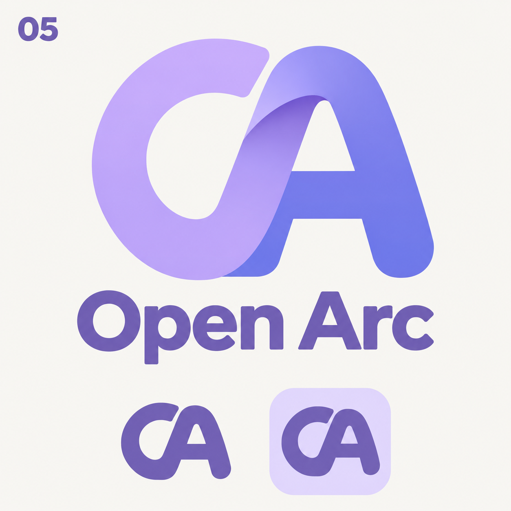
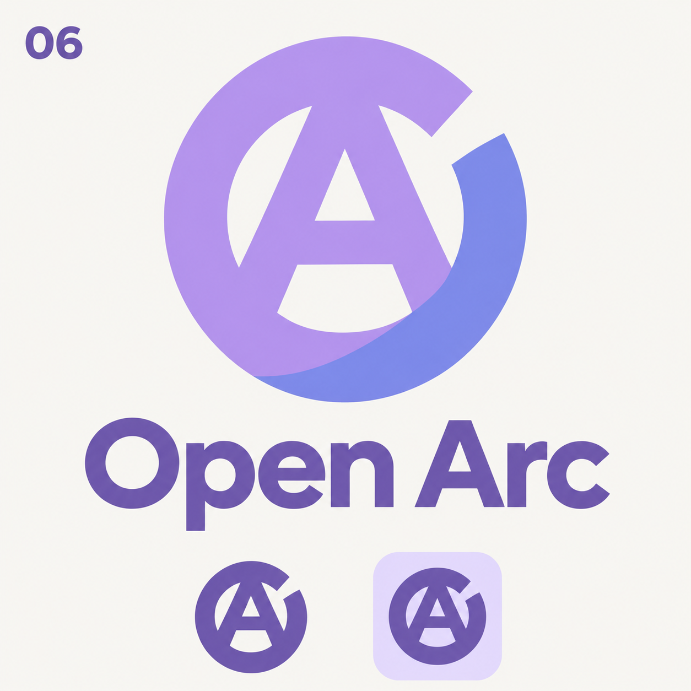
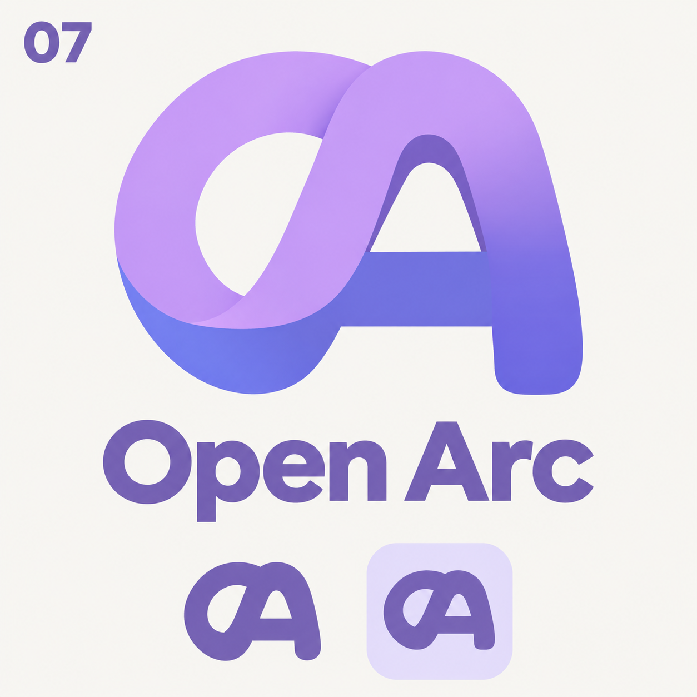

# Open Arc logo exploration — round 3

Generated with the built-in imagegen tool. Three bolder OA monogram studies for selection; the production logo is unchanged.

User direction: restore a recognizable letter A and increase stroke weight while retaining an open O, folded surfaces, and a purple/blue palette with no pure black.

## Shared generation prompt

Use case: logo-brand. Design a new original Open Arc browser logo. User feedback: the previous open-circle concepts lost all trace of the LETTER A and their strokes were too thin. Correct BOTH issues emphatically. The symbol must unmistakably contain BOTH the letter O and the letter A in a single compact, chunky monogram. Thick substantial filled bands, stroke thickness approximately 20-24% of the overall emblem diameter, generous but compact counters, strong small-size silhouette. Not thin lines, not a C, not just an open ring, not a generic swirl. Preserve refined lavender and periwinkle color planes and one subtle folded-surface transition. ALL text and monochrome samples must be medium violet #7160B5, no black, charcoal or black-looking elements. Ivory background #f8f7f3. Square presentation with one large centered logo above exact 'Open Arc' wordmark, a small concept number top-left, and below the wordmark the SAME logo as a solid violet small mark and in a pale lavender rounded-square app tile. Consistent geometry at all sizes. Design the monogram as a compact emblem, not two unrelated letters. Avoid the familiar standalone triangular ribbon A with a sweeping curved crossbar used by the Arc browser. The O must materially define the outer silhouette. No additional text, no decorative stars, no rainbow, no chrome gloss.

## 05 — Shared-stroke OA

Build a broad O on the left and a clearly readable rounded-top capital A on the right, overlapped into one cohesive roughly square monogram. The O's right curve becomes the A's left leg; a strong visible straight crossbar and two legs make the A legible. O left side lavender, A right side periwinkle, one short overlap/fold at the shared stroke. O has a small intentional break near upper-right. Outer shape balanced, soft terminals, substantially thick strokes, no triangular outer peak.

Final prompt suffix: The exact corner label is '05'.

## 06 — A within O

A bold thick circular O frame with a small opening at upper-right contains a highly legible capital A cut out of the center. The A-shaped negative space has two distinct legs and a visible horizontal crossbar formed by the solid violet material. The A is the main internal reading; outer silhouette remains a circular O. Emblem like a beautifully drawn typographic ligature. Outer band lavender, lower-right folded face periwinkle. Favor clean solid masses and clear letter anatomy over clever abstract ornament.

Final prompt suffix: The exact corner label is '06'.

## 07 — Folded OA ligature

A thick open O loop bends into a broad rounded A on its right half, creating one continuous folded ribbon ligature. BOTH letters must be readable: the left circular O counter is visible, the right A has an obvious counter, crossbar, and descending right leg. Compact near-square footprint, overlapping letters rather than side-by-side wordmark. A heavy periwinkle horizontal crossbar is integrated into the lower center; lavender upper curved face, one blue underside fold. Architectural rounded arch crown instead of triangular A apex. Much bolder and more compact than a thin circular ribbon.

Final prompt suffix: The exact corner label is '07'.
