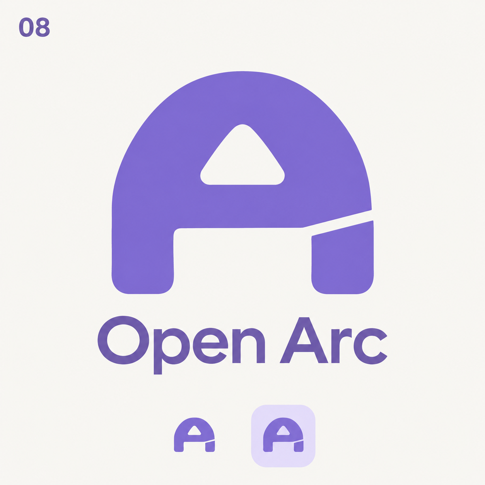
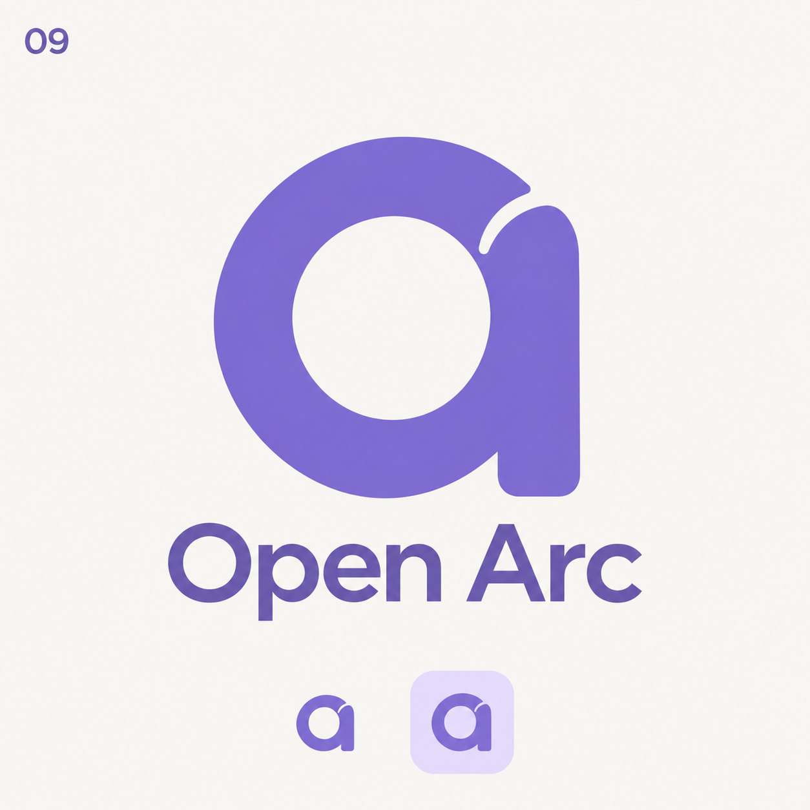

# Open Arc logo exploration — round 4

Two simplified concept boards generated with the built-in imagegen tool. These are proposals; no production asset is replaced.

Direction: simplify the previous OA ligatures into a single bold silhouette, preserve an A/a reading, use purple without black, and remove folded overlays and gradient complexity.

## Shared prompt

Use case: logo-brand. Create an exceptionally SIMPLE original logo for Open Arc, a browser. Previous designs became too complex with interlocking OA letters, folded ribbons and gradients. This revision must be radically simpler: ONE bold solid silhouette, ONE clear counter, no intertwined letters, no folds, no overlapping surfaces, no 3D, no shading, no gradient, no decorative extras. Single flat medium periwinkle #8272D8 for the symbol and a muted purple #7160B5 wordmark; no black or charcoal anywhere. Thick friendly geometry, beautifully balanced negative space, crisp vector-like edges. Recognizable letter A hint integrated naturally, not an elaborate literal OA ligature. Do NOT reproduce the Arc browser rainbow triangular ribbon mark. Presentation: square ivory background #F8F7F3, large symbol centered, exact wordmark 'Open Arc' below in understated medium-weight sans serif (NOT extra-bold). Bottom: a tiny copy of the SAME mark at favicon scale and another on a pale lavender rounded-square app tile. Small concept number top-left. Lots of whitespace. No other text.

## 08 — Open arch

A single thick rounded arch-shaped capital A silhouette, almost like an architectural doorway with softly rounded shoulders. One small simple rounded triangular counter above a straight thick crossbar, an open bottom between two short legs. Cut ONE narrow deliberate break at the right junction of the crossbar and right leg, making the structure subtly open. Compact slightly wider-than-tall proportions, substantial even stroke, completely flat one-color mass. No surrounding circle, no separate O, no swoosh, no long tail. It should be as simple as a beautifully custom-drawn single letter.

Prompt suffix: The corner label must read '08'.

## 09 — Open bowl

A single compact thick circular lowercase-a-like glyph: one rounded O-shaped bowl with one large circular counter, a short integrated upright right stem, and a tiny clean gap where the upper bowl approaches the stem. This should read as a simple rounded A/a with an open O embedded in its bowl. One unified solid color shape, no overlapping letters, no extra interior bar, no tail flourish. The stem ends at the same baseline as the bowl. Extremely economical icon, almost square footprint, subtly softened corners, not a C or G.

Prompt suffix: The corner label must read '09'.
